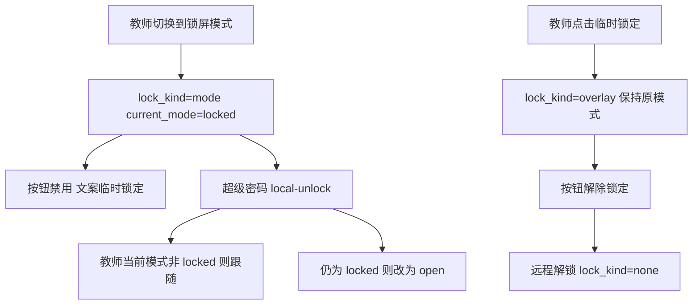

# 锁屏模式与临时锁定区分

Feature Name: lock-kind-naming
Updated: 2026-10-19

## Description

教师端用 `lock_kind` 区分锁屏模式与临时锁定。设备管理将锁屏/解锁合并为切换按钮。锁屏模式禁止远程解锁。超级密码解锁锁屏模式时按教师端当时模式恢复。开放模式签到窗口保持前台与姓名框焦点。

开放模式签到窗口在启动后申请系统前台；姓名框只在尚未获得过焦点时请求输入焦点，避免点击后被重复 request_focus 打掉。

## Architecture

临时锁定只覆盖锁屏进程，不改 `current_mode`。锁屏模式走现有模式切换，结束使用会话。

## Components and Interfaces

`teacher-server` 迁移增加 `student_devices.lock_kind`。

`remember_mode_and_lock` 只写 `overlay`，保持 `current_mode`。

`switch_device_mode` / 班级切模式：目标为 `locked` 时写 `mode`，其他目标写 `none`。

`unlock_handler` 在 `lock_kind=mode` 时返回错误。

`local_unlock_handler` 允许两种锁定；锁屏模式按教师当前模式或开放模式返回 `restore_mode`。

`teacher-web` `Devices.vue` 合并按钮，模式列展示「锁屏模式」或「原模式 + 临时锁定」。

`student-agent` `LockScreen` 命令保持 `current_mode`，只置 `lock_is_overlay`。

`campus-checkin` 开放模式置顶；姓名框仅在尚未获得过焦点时 `request_focus`。窗口启动时申请一次系统前台。开放模式焦点守护只从桌面、资源管理器、控制台、任务栏夺回前台。

`agent-core` 签到启动时对签到进程 `AllowSetForegroundWindow`。教师端与学生端 Windows 构建为无控制台子系统，任务栏显示最小化状态窗口；日志写入 `logs/` 日滚文件。教师日志中心可通过 `collect_logs` 命令收集学生机日志到 `logs/students/`。

## Data Models

`student_devices.lock_kind TEXT NOT NULL DEFAULT 'none'`

取值：`none`、`overlay`、`mode`

`DeviceResponse.lockKind` 随设备列表返回。

## Correctness Properties

临时锁定期间 `current_mode` 仍为开放、授课或考试。

锁屏模式期间远程解锁接口保持设备为锁屏模式。

超级密码解锁锁屏模式后设备 `lock_kind` 为 `none`，`current_mode` 为开放、授课或考试之一。

## Error Handling

对锁屏模式调用 `/unlock`：业务错误，提示通过切换模式退出。

`local-unlock` 网络失败：学生机使用本地 `mode_before_lock` 回退。

## Test Strategy

teacher-server：临时锁定保持 current_mode；锁屏模式拒绝远程解锁；本地解锁跟随或改开放。

campus-checkin：焦点守护对控制台/桌面类名执行抢焦点；姓名框获得过焦点后停止重复 `request_focus`。

## References

[^1]: (Filename) - Devices.vue 设备操作列
[^2]: (Filename) - teacher-server/src/domain/device.rs 锁定与模式切换
