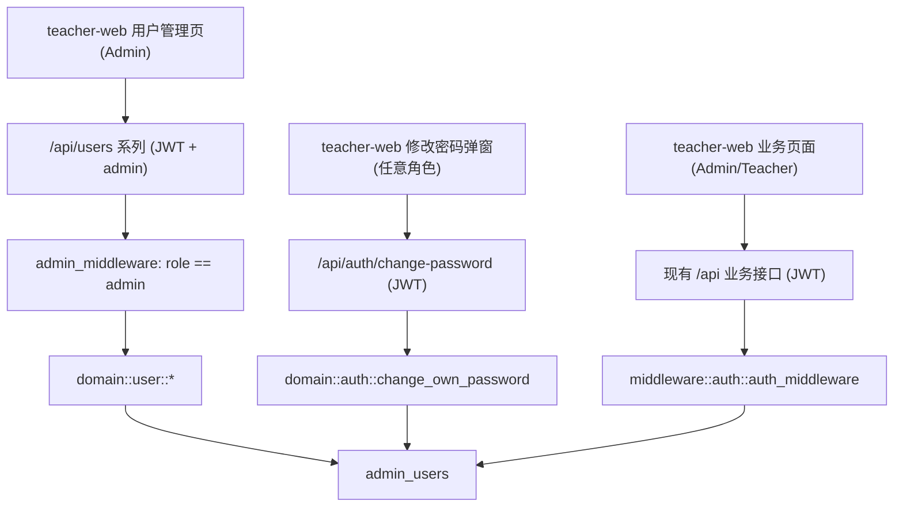
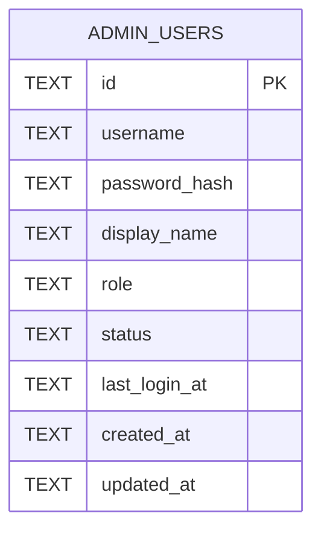

# 教师端用户管理

Feature Name: teacher-user-management
Updated: 2026-09-30

## Description

在教师端增加基于 `admin_users` 表的账号管理能力。内置管理员 `admin` 创建、修改、停用、删除教师账号并重置教师密码；教师账号登录后使用除用户管理外的教师端业务功能；所有已登录账号可修改本人密码。

现有基础：`admin_users` 表（迁移 `0012`）已具备 `id`、`username`、`password_hash`、`display_name`、`role`、`status`、`last_login_at`、`created_at`、`updated_at`；`domain::auth::login` 已按 `username + status='active'` 校验并在 JWT 中写入 `role`。本次不新增数据库迁移，仅扩展领域方法与接口。

## Architecture

访问控制分三层：

1. `auth_middleware` 校验 JWT，把 `Claims` 写入请求扩展，覆盖现有全部受保护路由。
2. 新增 `admin_middleware` 仅作用于 `/api/users` 子路由，读取 `Claims.role`，非 `admin` 返回 403。
3. 前端按 `localStorage.user.role` 控制菜单渲染与路由守卫；后端校验为准。

## Components and Interfaces

### 后端领域层 `domain::user`

- `list_users(pool) -> Vec<AdminUserView>`：返回全部账号，字段 `id`、`username`、`display_name`、`role`、`status`、`last_login_at`、`created_at`；不含 `password_hash`。
- `create_teacher(pool, username, password, display_name) -> AdminUserView`：校验用户名非空且不为 `admin`、密码长度不少于 4；用户名唯一冲突返回错误；`role='teacher'`、`status='active'`。
- `update_user(pool, id, display_name: Option<String>, status: Option<String>) -> AdminUserView`：目标为内置管理员时拒绝改用户名与改状态；`status` 仅接受 `active`/`disabled`。
- `delete_user(pool, id) -> ()`：目标用户名为 `admin` 时拒绝。
- `reset_teacher_password(pool, id, new_password) -> ()`：目标用户名为 `admin` 时拒绝；密码长度不少于 4。
- `change_own_password(pool, user_id, old_password, new_password) -> ()`：校验旧密码、新密码长度不少于 4，仅更新 `user_id` 对应记录。
- 复用 `domain::auth` 中现有的 bcrypt、`AdminUser` 结构；`AuthError`/`anyhow` 返回可读中文消息。

### 后端接口层

| 方法 | 路径 | 权限 | 说明 |
|---|---|---|---|
| GET | `/api/users` | admin | 列出账号 |
| POST | `/api/users` | admin | 新增教师 |
| PUT | `/api/users/:id` | admin | 修改显示名/状态 |
| DELETE | `/api/users/:id` | admin | 删除教师 |
| POST | `/api/users/:id/reset-password` | admin | 重置教师密码 |
| POST | `/api/auth/change-password` | 登录用户 | 修改本人密码 |

请求体统一 camelCase：新增 `{ username, password, displayName }`；修改 `{ displayName?, status? }`；重置 `{ newPassword }`；改本人密码 `{ oldPassword, newPassword }`。

### 前端

- `api/users.ts`：封装上述 5 个用户管理接口与 1 个改密接口。
- `views/Users.vue`：账号列表、新增教师弹窗、编辑状态/显示名、重置密码、删除确认。
- `components/Layout.vue`：`role === 'admin'` 时渲染「用户管理」菜单；页头显示 `displayName || username`；对所有登录用户提供「修改密码」入口。
- `router/index.ts`：新增 `/users` 路由，`meta.requiresAdmin = true`；全局前置守卫：未登录跳 `/login`，`requiresAdmin` 且角色非 admin 跳 `/dashboard`。
- `views/Login.vue`：登录成功后已保存 `role`，无需改动。

## Data Models

复用 `admin_users`（迁移 `0012`）：

- `role`：`admin` 为内置管理员，`teacher` 为教师。
- `status`：`active` 可登录，`disabled` 不可登录。
- 无新增迁移；`init_default_admin` 保持现有逻辑，仅内置 `admin` 一条角色为 `admin`。

## Correctness Properties

1. `admin_users` 中 `username='admin'` 的记录始终存在、`status='active'`、`role='admin'`。
2. 任何接口都不会删除或停用内置管理员，也不会把内置管理员的用户名改为其他值。
3. 任一时刻 `role='admin'` 的账号至多一个，即内置管理员。
4. 用户列表响应不含 `password_hash`。
5. 密码以 bcrypt 哈希存储，任何响应不回传哈希或明文。
6. 非 admin 角色访问 `/api/users*` 一律 403，且不产生数据变更。

## Error Handling

- 用户名重复：返回 400 与「用户名已存在」。
- 用户名为 `admin` 的新增：返回 400 与「内置管理员账号不可创建」。
- 删除/停用/重置内置管理员：返回 400 与「内置管理员账号不可删除或停用」。
- 旧密码错误：返回 400 与「当前密码不正确」。
- 新密码长度不足：返回 400 与「新密码长度不得少于 4 位」。
- 目标账号不存在：返回 404。
- 非 admin 访问：返回 403 与「无权限执行该操作」。
- 未携带有效 JWT：返回 401，沿用现有前端拦截器跳转登录页。

## Test Strategy

- 领域层单测（内存 SQLite + `setup_pool`）：
  - 创建教师成功、用户名重复失败、用户名为 `admin` 失败。
  - 列出用户不含密码哈希。
  - 停用教师后 `login` 拒绝。
  - 删除教师成功、删除 `admin` 失败。
  - 重置教师密码成功、重置 `admin` 失败。
  - `change_own_password` 校验旧密码与最小长度，成功后旧密码失效、新密码可登录。
  - JWT 角色：教师登录 `role='teacher'`，管理员登录 `role='admin'`。
- 接口层：`admin_middleware` 对非 admin 令牌返回 403。
- 前端手动验证：admin 可见用户管理菜单、教师不可见且直连 `/users` 被重定向；教师可正常进入业务页面；页头显示当前账号显示名。

## References

- [^1]: (File) - `CampusLink-NCMS/teacher-server/migrations/0012_create_admin_users.sql`
- [^2]: (File) - `CampusLink-NCMS/teacher-server/src/domain/auth.rs`
- [^3]: (File) - `CampusLink-NCMS/teacher-server/src/api/mod.rs`
- [^4]: (File) - `CampusLink-NCMS/teacher-server/src/middleware/auth.rs`
- [^5]: (File) - `CampusLink-NCMS/teacher-web/src/components/Layout.vue`
- [^6]: (File) - `CampusLink-NCMS/teacher-web/src/router/index.ts`
