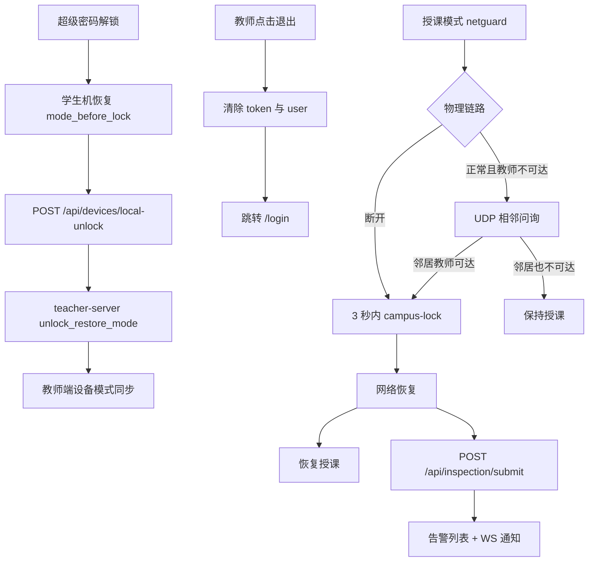

# 解锁同步、退出登录与授课断网锁定

Feature Name: unlock-logout-network-guard
Updated: 2026-10-11

## 描述

三件事：

1. 学生机超级密码解锁后，教师端当前模式改回 `mode_before_lock`，进行中的使用会话保持未结束。
2. 教师端页眉增加「退出」，清除本地 token 后回登录页。
3. 授课模式下用网卡链路状态与相邻学生机问询区分拔网线、故意阻断、教师机死机；前两种立即锁屏，网络恢复后恢复授课并写检查告警。

## 架构

## 组件与接口

### 1. 超级密码解锁同步

根因：教师远程锁定走 `remember_mode_and_lock`，教师端 `current_mode=locked`。学生本地超级密码解锁只改学生机配置并发 JSON 心跳；`process_heartbeat_json` 只更新 `last_seen_at`，不改模式。

新增公开路由 `POST /api/devices/local-unlock`，请求体 `{ "device_id": "..." }`。校验设备已注册后调用现有 `unlock_restore_mode`，把库中模式写成 `mode_before_lock`。不向该设备再广播 `unlock` 命令。使用会话保持未结束。

学生端：`campus-lock` 退出后的 `unlock_rx` 路径、以及签到窗超级密码退出路径，在本地 `apply_unlock_restore` 之后调用该接口。

JSON 心跳补充：若心跳带 `mode` 且值是 `open`/`teaching`/`exam`，且库中当前为 `locked`，同样走 `unlock_restore_mode`，作为接口失败时的补同步。

教师远程解锁路径保持现有 `/api/devices/:id/unlock`。

### 2. 教师端退出

`Layout.vue` 页眉用户区在「修改密码」旁增加「退出」。点击后调用 `useWebSocket().disconnect()`，删除 `localStorage` 的 `token` 与 `user`，`router.push('/login')`。无服务端注销接口。

### 3. 授课断网锁定

新增 `student-agent/agent-core/src/netguard.rs`，在心跳循环中每 1 秒执行。仅 `current_mode == teaching` 且当前未处于网络异常锁屏时判定锁定；已锁定时只检测恢复。

判定顺序：

1. 物理链路断开：Windows 用活动以太网/WLAN 适配器 `OperStatus` 非 Up；3 秒内拉起 `campus-lock`（overlay，`remember_mode_before_lock(..., true)`），原因 `physical_link`。
2. 物理链路正常且 WebSocket 已断开：向 `255.255.255.255:9998` 发 `CAMPUSLINK_PEER_PING`，等待 2 秒；无应答再发 1 次。
3. 收到至少一条 `teacher_reachable=true` 的 pong：原因 `firewall_block`，同样 overlay 锁屏。
4. 全部 pong 为 `teacher_reachable=false`，或两次问询均无应答：视为教师机故障，保持授课并继续重连。

每个学生机进程绑定 `0.0.0.0:9998` 应答问询。pong JSON：`{"type":"peer_pong","device_id":"...","teacher_reachable":true}`。`teacher_reachable` 取本机 WebSocket 当前是否已连接。

网络恢复：物理链路 Up 且 WebSocket 重连成功，且当前是网络异常锁屏。此时 `apply_unlock_restore` 回授课，overlay 解锁不重新拉签到。随后 `inspection::report_abnormal`：

- `inspection_type = "network"`
- `item_name`：`physical_link` 或 `firewall_block`
- `status = abnormal`
- 描述含设备名与原因中文

`submit_inspection_handler` 在 `is_abnormal` 为真时向教师端 WS 广播 `{"type":"alert","alert_type":"network","device_id":"...","description":"..."}`。`Alerts.vue` 增加网络类型中文标签。`useWebSocket` 对 `network` 显示「网络告警」通知。

网络异常锁屏不调用 `close_open_session`。

## 数据模型

无新表。复用：

| 用途 | 现有字段/接口 |
| --- | --- |
| 解锁前模式 | `student_devices.mode_before_lock` |
| 教师端模式 | `student_devices.current_mode` |
| 使用会话 | `device_usage_records.end_time` 保持空 |
| 告警 | `inspection_records`，`inspection_type=network` |

学生机内存增加：`network_lock_reason: Option<physical_link|firewall_block>`，锁屏期间保存，恢复后清空。

## 正确性属性

1. 超级密码解锁后，教师端 `current_mode` 等于解锁前的 `open`/`teaching`/`exam`。
2. 锁定与网络异常锁屏都不结束进行中的使用会话。
3. 教师机死机且邻居同样不可达时，授课学生机保持授课。
4. 邻居报告教师可达且本机教师不可达且链路 Up 时，本机进入锁定。
5. 网络恢复后学生机模式回到授课，并产生一条 abnormal 告警。

## 错误处理

| 场景 | 处理 |
| --- | --- |
| local-unlock 请求失败 | 下一次心跳按 locked→授课 补同步 |
| 9998 端口占用 | 打 warn，物理链路判定仍生效，问询失败按教师机故障保持授课 |
| 告警提交失败 | 重连后重试一次 |
| 非 Windows 环境 | 物理链路读取失败时跳过链路判定，只走问询 |

## 测试策略

1. `unlock_restore_mode`：locked + mode_before_lock=teaching → current_mode=teaching，使用会话 end_time 仍空。
2. `process_heartbeat_json`：locked 设备心跳 mode=teaching → 库中变为 teaching。
3. netguard 纯函数：链路断开→physical_link；邻居 teacher_reachable=true→firewall_block；邻居全 false→保持授课。
4. 教师端退出为页面操作，手工确认清 token 回登录页。
