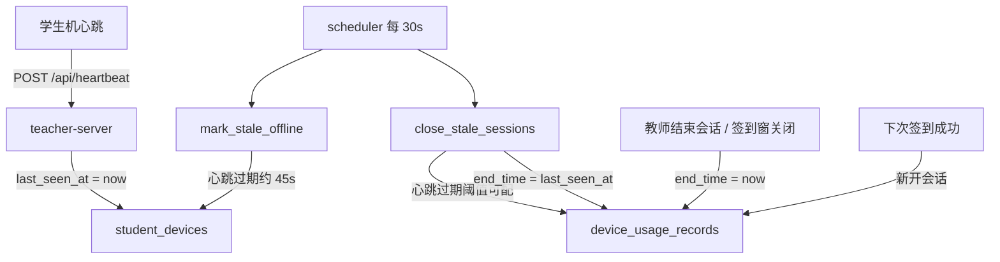

# 使用记录心跳超时收口

Feature Name: usage-heartbeat-timeout
Updated: 2026-10-11

## 描述

学生机关机或断连、教师未点「结束会话」时，`device_usage_records.end_time` 会一直为空。本设计在教师服务器调度器中增加未结束会话扫描：心跳超过会话超时阈值未更新时，用该设备 `last_seen_at` 作为结束时间并写入时长。阈值存放在 `system_configs.usage_session_timeout_seconds`，缺省 60 秒。教师主动结束、签到窗关闭仍写当前时间。列表与导出不加结束原因字段。

改动范围仅 `teacher-server`。学生端心跳、教师端使用查询页面保持现有行为。

## 架构



调度器已有 30 秒周期。离线标记与会话收口同一次 tick 内先后执行，阈值分开：离线约 45 秒，会话 60 秒。

扫描周期 30 秒。缺省阈值 60 秒时，实际关闭窗口约为最后心跳后 60 到 90 秒。

## 组件与接口

### 领域：`teacher-server/src/domain/usage.rs`

新增常量 `DEFAULT_USAGE_SESSION_TIMEOUT_SECONDS = 60` 与配置键 `usage_session_timeout_seconds`。

新增 `usage_session_timeout_seconds(pool) -> Result<u32>`：读取配置，缺失、无法解析或小于 1 时返回 60。

新增 `close_stale_sessions(pool) -> Result<u64>`：

1. 找出 `end_time IS NULL` 的使用会话。
2. 关联 `student_devices.last_seen_at`。
3. 仅处理 `last_seen_at IS NOT NULL` 且 `last_seen_at < datetime('now', '-{timeout} seconds')` 的行。
4. 将这些行的 `end_time` 设为对应设备的 `last_seen_at`。
5. `duration_seconds = MAX(0, CAST((julianday(last_seen_at) - julianday(start_time)) * 86400 AS INTEGER))`。
6. 返回受影响行数。

`close_open_session`、`end_session` 保持 `datetime('now')`，供签到窗关闭、模式切换清理、教师手动结束使用。

`start_session` / `reuse_or_start_session` 行为不变：下次签到成功才开新会话。超时关闭后设备仅恢复心跳，不会自动续上旧会话。

考试模式 `ensure_exam_session` 在连接时调用：若旧考试会话已被超时关闭，重连会开一条新考试会话，符合「下次登记再开新记录」。

### 调度器：`teacher-server/src/scheduler.rs`

在现有循环中，`mark_stale_offline` 之后调用 `usage::close_stale_sessions`。关闭行数大于 0 时打 info 日志。失败打 error，不中断后续 tick。
每轮 tick 重新读取配置，管理员改阈值后下一次扫描生效。

### HTTP / 前端

无新接口。`GET /api/usage`、`GET /api/usage/export`、`POST /api/usage/:id/end`、`POST /api/usage/close` 契约不变。教师端 `Usage.vue` 无需改字段。
阈值通过 `system_configs` 读写，本期教师端设置页不加表单项。

## 数据模型

沿用 `device_usage_records` 与 `student_devices.last_seen_at`，不加列、不加结束原因。

新增种子配置（迁移 `0020_usage_session_timeout.sql`）：

| 键 | 缺省值 | 说明 |
| --- | --- | --- |
| usage_session_timeout_seconds | 60 | 未结束使用会话的心跳超时秒数 |

| 关闭路径 | end_time | duration_seconds |
| --- | --- | --- |
| 心跳超时 | `student_devices.last_seen_at` | start_time 到 last_seen_at |
| 教师结束 / 签到窗关闭 / 模式切换清理 | `datetime('now')` | start_time 到 now |

SQL 示意：

```sql
UPDATE device_usage_records
SET end_time = (
      SELECT last_seen_at FROM student_devices
      WHERE student_devices.id = device_usage_records.device_id
    ),
    duration_seconds = MAX(0, CAST((
      julianday((
        SELECT last_seen_at FROM student_devices
        WHERE student_devices.id = device_usage_records.device_id
      )) - julianday(start_time)
    ) * 86400 AS INTEGER))
WHERE end_time IS NULL
  AND EXISTS (
    SELECT 1 FROM student_devices d
    WHERE d.id = device_usage_records.device_id
      AND d.last_seen_at IS NOT NULL
      AND d.last_seen_at < datetime('now', ?)
  );
```

## 错误处理

| 场景 | 处理 |
| --- | --- |
| 设备无 last_seen_at | 本轮跳过该会话 |
| 关闭 SQL 失败 | 打 error，下个 30 秒周期重试 |
| 教师结束与超时扫描并发 | `WHERE end_time IS NULL` 保证只写一次；教师路径写 now，超时路径写 last_seen_at |
| start_time 晚于 last_seen_at | duration_seconds 取 0 |
| 配置缺失或非法 | 使用 60 秒 |

## 测试策略

在 `usage.rs` 的 `#[cfg(test)]` 中用现有 `setup_pool` / `register_test_device` 覆盖：

1. last_seen_at 早于当前阈值：未结束会话被关闭，end_time 等于 last_seen_at，duration 为 start 到 last_seen 的秒数。
2. last_seen_at 在阈值内：会话保持未结束。
3. last_seen_at 为空：会话保持未结束。
4. `end_session` 仍把 end_time 写成当前时间。
5. 超时关闭后再 `start_session`：旧记录结束时间不变，产生新记录。
6. 配置缺失或非法时按 60 秒关闭；写入自定义正整数后按下值关闭。
